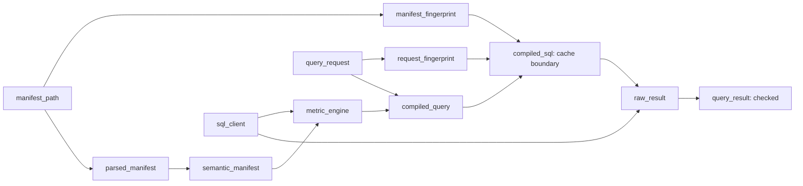

# HamiltonFlow

MetricFlow semantic queries, orchestrated as an inspectable [Apache Hamilton](https://github.com/apache/hamilton)
dataflow, with interchange (Ossie, LookML) and an agent-friendly serving layer.

MetricFlow (the upstream semantic parser, planner, optimizer and SQL renderers) is
installed from PyPI as a pinned dependency (`metricflow==0.213.0`); nothing is
forked or vendored. HamiltonFlow adds what MetricFlow alone does not:

| Capability | What you get |
|---|---|
| **Cached compilation** | Compiled SQL cached on *manifest content hash + request hash + dialect*; a hit skips parse, validate, plan and render (in memory or on disk). |
| **Lineage** | Every DAG node carries a `stage` tag (`ingest, parse, validate, plan, render, execute, check`); `flow.lineage()` returns the graph; optional OpenLineage run events list the physical tables each query read. |
| **Result checks** | Hamilton `@check_output_custom` validates the result shape before it is returned. |
| **Structured errors** | `ManifestError`, `RequestError`, `WarehouseError` (+ `to_dict()`); Pydantic request validation with field-level messages. |
| **Interchange** | Apache Ossie import/export, LookML import, each with an explicit report of what could not be converted. |
| **Serving** | Web Explorer UI, FastAPI app and MCP server exposing `catalog`, `explain`, `query`. |

## Support matrix

| Backend | Status | Evidence |
|---|---|---|
| DuckDB | **Supported** | Integration + property-based parity tests against direct MetricFlow on every CI run. |
| ClickHouse | **Certified in CI (via SQLGlot bridge)** | Live parity tests vs DuckDB on a real ClickHouse server (`tests/live`). Not a native MetricFlow backend: SQL is translated from the DuckDB renderer, so unsupported constructs fail rather than fall back. |
| Snowflake | Experimental | Native MetricFlow renderer; offline SQL tests only. No live run. |
| Databricks | Experimental | Native MetricFlow renderer; offline SQL tests only. No live run. |

See [WAREHOUSES.md](WAREHOUSES.md) for connection configuration.
Materialization (SQLMesh projects, run ledger) is **not** part of this package; see
the warehouse doc for the retained helper and its limits.

## Install

```sh
pip install -e .                 # Python 3.11+
pip install -e '.[serve]'        # FastAPI / MCP server
pip install -e '.[clickhouse]'   # or .[snowflake], .[databricks]
pip install lkml                 # only for LookML import
```

## Quick start

```sh
python -c "import duckdb,pathlib; c=duckdb.connect('demo.duckdb'); c.execute(pathlib.Path('examples/setup.sql').read_text()); c.close()"
hamilton-flow catalog --manifest examples/semantic
hamilton-flow explain --manifest examples/semantic --request examples/query.json
hamilton-flow query   --manifest examples/semantic --database demo.duckdb --request examples/query.json --cache .hf-cache
```

Failures print a JSON error to stderr and exit non-zero by kind
(`2` request, `3` manifest, `4` warehouse, `5` result check).

```python
import duckdb
from hamilton_flow import HamiltonFlow
from hamilton_flow.client import DuckDBClient
from hamilton_flow.requests import request_from_dict

with duckdb.connect("demo.duckdb") as connection:
    flow = HamiltonFlow("examples/semantic", DuckDBClient(connection),
                        cache=".hf-cache", lineage_sink=print)
    request = request_from_dict({"metric_names": ["revenue"], "group_by_names": ["customer__country"]})
    result = flow.query(request)          # QueryResult: .columns .rows .sql .to_records()
```

Native `MetricFlowQueryRequest` objects are also accepted.

## The DAG



`compiled_query` is MetricFlow's own `explain()`, deliberately not re-implemented:
dimension resolution, dataflow planning and rendering are one upstream call, so
output stays identical to MetricFlow (asserted by property-based tests).

## Interchange

```sh
hamilton-flow import-ossie  --input model.ossie.yaml --output converted/
hamilton-flow export-ossie  --manifest examples/semantic --output model.ossie.yaml
hamilton-flow import-lookml --input views/ --output converted/
```

Each prints a `report` with `converted` and `unsupported` entries.

* **Ossie (0.2.0.dev0)** - output is validated against the official JSON schema in tests.
  Imports datasets, single-column keys, many-to-one relationships, fields, single-aggregate
  metrics and ratios of two aggregates. Not converted: window-function metrics,
  composite keys, query-backed sources, and metrics whose dataset has no time field
  (MetricFlow needs an aggregation time dimension).
* **LookML** - views, dimensions, time dimension groups, primary keys, simple measures
  and many-to-one joins. Not converted: derived tables, liquid/templated SQL,
  `type: number` measures and table calculations, filtered measures, one-to-many joins,
  tier/bin dimensions, access filters.

Converted projects need a physical `time_spine` table (the converter writes the
`project_configuration`; default `main.time_spine`).

## Serving

```sh
hamilton-flow serve --manifest examples/semantic --database demo.duckdb --transport http      # POST /query /explain, GET /catalog /lineage
hamilton-flow serve --manifest examples/semantic --database demo.duckdb --transport mcp       # stdio MCP for agents
```

Open `http://127.0.0.1:8000/` for the **Explorer**: pick metrics and compatible group-bys, filter, run or explain, and see results, SQL, cache hit/miss and the DAG with per-node timings (nodes skipped by a cache hit are dashed).

Requests are serialized (one session owns one SQL connection). There is no authentication:
put it behind your own gateway and use a read-only database user. Manifest filter
expressions are trusted project code, as in upstream MetricFlow.

### Builder UI: configure data, models and metrics

```sh
hamilton-flow serve --project my-project          # creates my-project/data.duckdb and my-project/model.{json,yaml}
hamilton-flow serve --project my-project --manifest examples/semantic --database demo.duckdb   # seed from an existing manifest
```

Open `http://127.0.0.1:8000/`:

1. **Data & models**: upload CSV / TSV / Parquet / JSON (max 50 MB) into the project's DuckDB, preview and drop tables, then *Model this table*. It drafts entities (`*_id` columns), dimensions (text, dates) and measures (numeric columns) that you can edit.
2. **Metrics**: add *simple*, *ratio*, *derived* or *cumulative* metrics. Ratio and derived metrics take **other metrics as inputs**, including other ratio/derived metrics, so metrics stack (revenue -> average order value -> net AOV). Derived inputs support aliases and offset windows (e.g. growth vs prior month).
3. Every edit is validated by MetricFlow as you type; **Save & apply** writes `model.json` (what the UI edits) and `model.yaml` (native MetricFlow YAML) and switches the Explorer to the new model. Invalid models are never saved.

Builder endpoints are mounted only with `--project`, can modify the project database, and have no authentication: keep the default `127.0.0.1` binding. Table loading needs the DuckDB project database; for Snowflake/Databricks/ClickHouse use `--warehouse` and write the model in YAML or via the import commands.

## Limits

* Synchronous; one session per client. Create separate sessions for concurrency.
* The `catalog`/`explain`/`query` surface is not a BI connector (no JDBC/ADBC).
* Snowflake and Databricks are untested live. See the matrix.

## Development

```sh
hatch run test                              # unit + integration (live tests skip)
CLICKHOUSE_HOST=localhost hatch run test tests/live   # needs a ClickHouse server
ruff check hamilton_flow tests
```

The upstream MetricFlow test-suite is not re-run here; HamiltonFlow's guarantee is
parity with a direct MetricFlow call, tested on random requests.
Independent project; not an official dbt Labs or Apache release.
